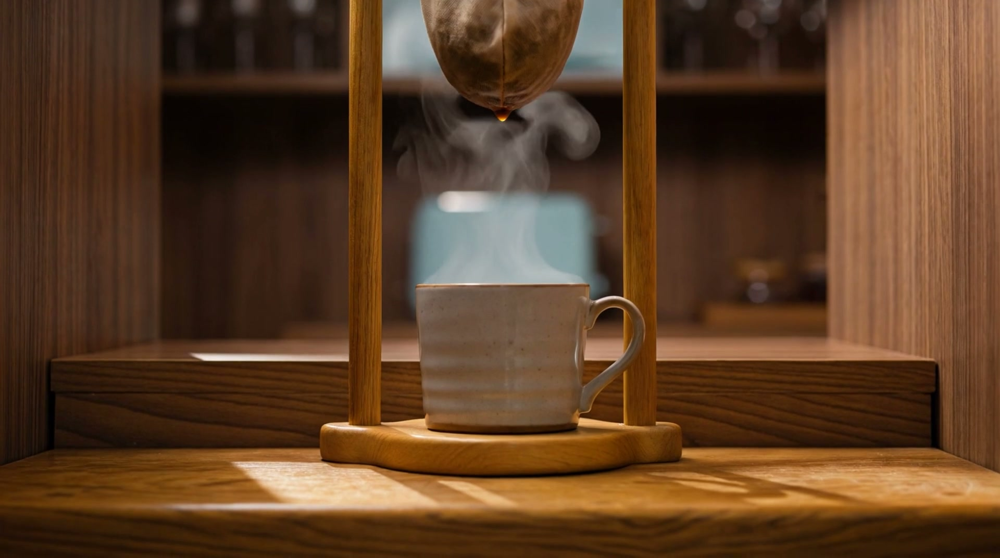

# Freijó Café e Padaria

Site de exemplo para uma cafeteria e padaria artesanal com tema de madeira, com um vídeo que acompanha a rolagem da página.



> **Marca fictícia**, criada para demonstração. Imagens e vídeo gerados por IA. Depoimentos ilustrativos.

## A ideia

Freijó é uma madeira brasileira nobre e dourada. O balcão levou décadas para crescer, o pão descansa 48 horas e o café pinga do coador de pano, gota a gota. O site inteiro ensina uma coisa só: **tudo que é bom leva tempo**. Isso transforma as duas objeções mais comuns dos clientes ("demora" e "é mais caro") no motivo para escolher o lugar.

A chamada principal é **reservar o pão do dia seguinte**, que resolve o "cheguei e já tinha acabado".

## O que tem no site

- **Hero com vídeo controlado pela rolagem:** a câmera desce acompanhando o fio de café do coador de pano até a xícara no balcão de madeira. Rolar para baixo avança o vídeo, rolar para cima volta. Quatro frases entram em sincronia com a cena.
- **"Aqui, cada coisa tem o seu relógio":** 48 horas do pão, 4 minutos do café e 30 minutos do pão de queijo, com anéis de crescimento da madeira que se desenham na tela.
- **Momento interativo:** segure o botão e o café pinga até encher a xícara. Se soltar antes, o café espera.
- **Cardápio** em estilo de comanda, com preços.
- **Como funciona a reserva** (3 passos), **O lugar**, **Depoimentos** e **Dúvidas**.
- **Formulário de reserva** com nome, WhatsApp, pão e horário de retirada.

## Estrutura

```
index.html   estrutura da página
style.css    todo o visual: cores, fontes, layout e animações em CSS
script.js    vídeo na rolagem, entradas dos textos, animações Motion, botão de coar e formulário
assets/      vídeo do hero, imagens do topo e do final, fotos dos passos e do lugar
```

HTML, CSS e JavaScript puros, sem build. A única biblioteca externa é a [Motion](https://motion.dev) 14.3.0, carregada pela CDN do jsDelivr.

## Animações

- **Vídeo do topo:** rolagem suavizada a cada quadro, buscas no vídeo que nunca se sobrepõem e vídeo codificado com um quadro-chave a cada 8 quadros. O resultado é uma rolagem lisa, inclusive no Chrome.
- **Motion:** entrada das seções com mola, cardápio entrando item por item, botões que reagem ao passar o mouse e ao clicar, e parallax na foto do lugar.
- **Linhas de madeira:** veios e anéis de crescimento em SVG que se desenham quando aparecem na tela.
- **Movimento reduzido:** quem ativa "reduzir movimento" no sistema vê tudo no estado final, sem animações e sem baixar o vídeo.

## Como ver localmente

```bash
npx http-server -p 8080
```

Depois abra `http://localhost:8080` no navegador.

Abrir o `index.html` com dois cliques também funciona, mas mostra uma imagem parada no lugar do vídeo, porque o navegador bloqueia o carregamento do vídeo em arquivos locais. É o mesmo visual que celulares recebem.

## Detalhes técnicos

- O vídeo é baixado inteiro (Blob) atrás de um anel de carregamento, para a rolagem funcionar em qualquer hospedagem.
- Celulares, tablets em pé e quem prefere menos movimento recebem a versão com imagem estática.
- Todos os textos sobre o vídeo passaram por medição de contraste no pior quadro (mínimo 3,5:1; o site ficou entre 8,8:1 e 12:1).
- O formulário é só demonstração: mostra a confirmação, mas não envia os dados para lugar nenhum.

## Créditos

Feito com Claude Code, a skill 10K Websites e a skill Motion. Imagens e vídeo gerados no Higgsfield.
